<div align="center">
  

  <br />

  <a href="https://github.com/Adam-Guerin?tab=repositories"></a>
  <a href="https://www.linkedin.com/in/adam-guerin"></a>
  <a href="mailto:adam.guerin.casa@gmail.com"></a>
</div>

<br />

### Hey, I'm Adam 👋

I'm a **builder and independent AI researcher based in Casablanca**. I turn ideas into products and explore a question that connects much of my work: **how do we make powerful AI systems useful while keeping people in control?**

Right now, I'm co-building **Aurels**, working on ways to check an AI agent's actions against user intent and permissions before they run. I also build tools for learning and personal execution, and research explainability, agent systems, and human–AI decision-making.

### Selected work

| Project | What I'm exploring |
| :--- | :--- |
| **[Aurels Plugins](https://github.com/Adam-Guerin/aurels-plugins)** | Open-source integrations and local evaluation tools for reviewing AI agent actions. |
| **[LucidAI](https://github.com/Adam-Guerin/LucidAI)** | AI explainability, fairness, and governance through a product and research benchmark. |
| **[BL4S](https://github.com/Adam-Guerin/BL4S)** | Geant4 simulation of non-invasive art analysis using high-energy electrons. |

### What I'm into

```text
AI agents & safety       →  action control, permissions, evaluations
Research                →  explainability, human–AI decisions
Products                →  education, productivity, automation
Beyond the screen       →  entrepreneurship, physics, endurance sport
```

### Tools I reach for

<p>
  
  
  
  
  
  
  
  
</p>

<br />

> Build systems that help humans think and act better.

<div align="center">
  <sub>Curious about AI agents, safer automation, or ambitious ideas? <a href="mailto:adam.guerin.casa@gmail.com">Let's talk.</a></sub>
</div>

